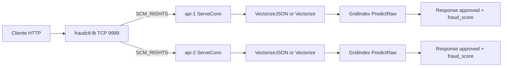

# fraudctl

API de detecção de fraude em Go para a Rinha de Backend 2026.

## Status Atual

- Runtime principal em Go puro com `fasthttp`
- Busca por similaridade com **Grid Index (KD-tree)** sobre `3_000_000` vetores de referência
- Balanceamento por um load balancer custom em Go com passagem de descritor de arquivo via `SCM_RIGHTS`
- Stack principal local: `2x API + 1x fraudctl-lb`
- Build principal da imagem gera `resources/grid.bin` em tempo de build Docker

## Arquitetura Atual



## Caminho de Requisição

1. O cliente envia `POST /fraud-score` para `:9999`.
2. `fraudctl-lb` aceita a conexão TCP e encaminha o socket aceito para uma API via Unix domain socket.
3. A API recebe o FD, reconstrói `net.Conn` e processa a conexão com `fasthttp.Server.ServeConn`.
4. O handler usa `VectorizeJSON` no hot path para montar o vetor de 14 dimensões.
5. O KNN roda `PredictRaw` no índice Grid carregado em memória.
6. A resposta é uma das seis cargas JSON pré-computadas, de `fraud_score` `0.0` a `1.0`.

## Decisão de Fraude

- `K = 5`
- `fraud_score = fraudCount / 5`
- `approved = fraudCount < 3`

Mapeamento direto:

| fraudCount | fraud_score | approved |
|---|---:|---|
| 0 | 0.0 | true |
| 1 | 0.2 | true |
| 2 | 0.4 | true |
| 3 | 0.6 | false |
| 4 | 0.8 | false |
| 5 | 1.0 | false |

## Implementação Atual do Grid Index

### Busca

- Formato do índice: `grid.bin` v2 (KD-tree)
- Partições por chave de 8 bits baseada em features da transação
- KD-tree por partição com split na dimensão mais larga
- Leaf size: 128 vetores por nó folha
- Layout block-major para compatibilidade com AVX2
- Precomputed f32 bbox bounds para cálculo rápido de distância
- Otimizações:
  - Early exit no bounds computation
  - Early exit quando worstDist = 0 (match exato)
  - Bounds pruning durante travessia da árvore

### Chave de Partição (8 bits)

| Bit | Feature | Condição |
|-----|---------|----------|
| 0 | last_tx | dim[5] >= 0 |
| 1 | is_online | dim[9] > 0 |
| 2 | card_present | dim[10] > 0 |
| 3 | unknown_merchant | dim[11] > 0 |
| 4-5 | mcc_bucket | dim[12] (0-3) |
| 6 | amount_high | dim[2] > 5000 |
| 7 | tx_count_high | dim[8] > 2500 |

### SIMD (AVX2)

O hot path do KNN usa SIMD via Go assembly em CPUs amd64:

| Função | SIMD | Operação |
|--------|------|----------|
| `ScanBlock8AVX2` | `VPMOVSXWD` + `VCVTDQ2PS` + `VFMADD231PS` | Distância L2 entre 8 vetores simultaneamente com early exit |

Dispatch automático: `init()` seta `useAVX2=true` em amd64. Em arm64 ou sem suporte, as implementações genéricas em Go puro são usadas.

### Otimizações Go

Além do SIMD, o hot path inclui:

- `//go:inline` em `newTopK5`, `worstDist`, `tryInsert`
- `tryInsert` desenrolado manualmente para K=5 (sem loop)
- Bounds checking hints para eliminar verificações redundantes
- Pre-computed f32 bbox bounds para evitar conversão int16→f32 no hot path
- Quantização `int16` com escala `10000`

## Stack Local

`docker-compose.yml` sobe:

- `api-1`
- `api-2`
- `fraudctl-lb`

Recursos configurados:

- API: limite `0.47 CPU`, `170M`
- LB: limite `0.5 CPU`, `10M`
- `GOMAXPROCS=1` em todos os containers
- `GOGC=off`

## Build e Execução

### Subir stack local

```bash
docker compose up -d
```

### Derrubar stack

```bash
docker compose down --volumes --remove-orphans
```

### Build da API

```bash
make docker-build
```

### Build do índice Grid

```bash
make build-grid
```

### Build do LB custom

```bash
make lb-docker-build
```

### Testes

```bash
make test
make k6-smoke
make k6-full
```

## Compliance com a Rinha

O projeto está estruturado para seguir as restrições do desafio:

- Sem cache de payloads de teste no runtime
- Sem lookup por ID de transação de teste
- Pré-processamento permitido de `references.json.gz`, `normalization.json` e `mcc_risk.json`
- Índice Grid construído em tempo de build, não em tempo de request
- Resposta sempre em JSON e com fallback para evitar HTTP errors em falhas de parse

Observações importantes do estado atual:

- Existe suporte no código para carregar `model.bin` e `gbdt.bin` em `dataset`, mas o handler atual não usa prefilter no caminho principal de produção.
- Existem arquivos legados em `config/` (`haproxy.cfg` e `nginx.conf`), mas o caminho principal atual usa `cmd/lb`.
- O índice IVF (`ivf.bin`) ainda é suportado como fallback caso `grid.bin` não esteja disponível.

## Documentação

- [docs/ARCHITECTURE.md](docs/ARCHITECTURE.md)
- [docs/API.md](docs/API.md)
- [docs/DETECTION_RULES.md](docs/DETECTION_RULES.md)
- [docs/EVALUATION.md](docs/EVALUATION.md)
- [docs/LOAD_BALANCER.md](docs/LOAD_BALANCER.md)
