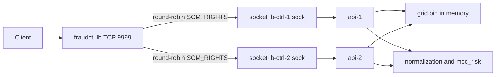
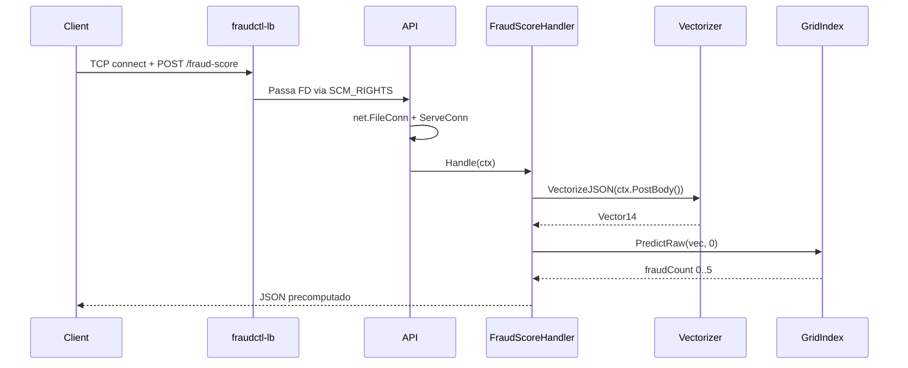
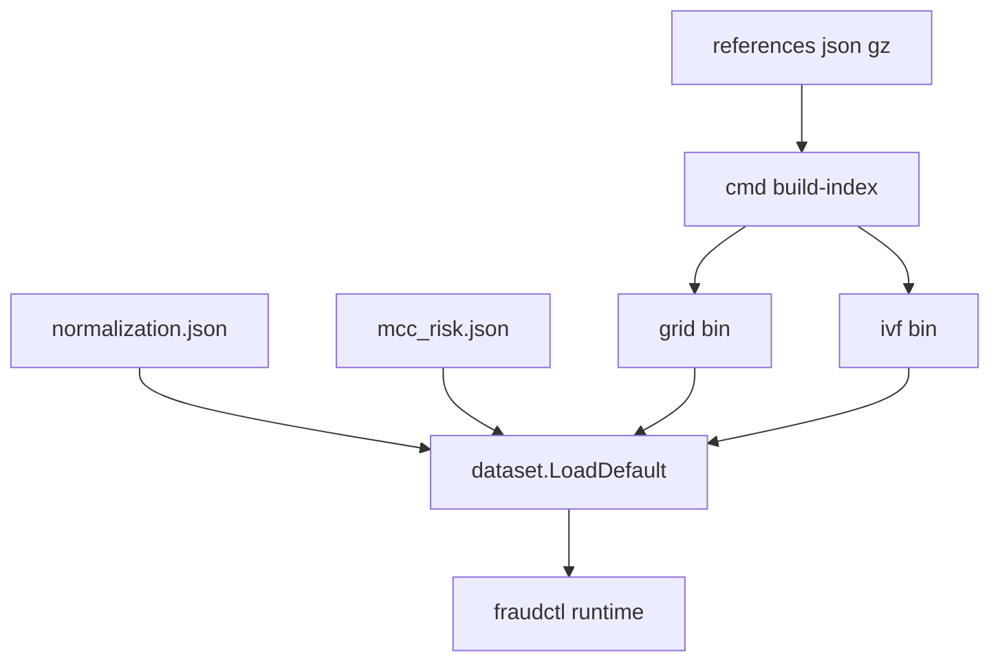

# Architecture

## Visão Geral

O caminho principal atual do projeto usa:

- `fraudctl-lb` como load balancer TCP custom
- `fasthttp` nas APIs
- `GridIndex` carregado de `resources/grid.bin` (KD-tree com partições de 8 bits)
- `VectorizeJSON` no hot path de requisição

## Topologia Atual

## Fluxo de Requisição

## Componentes

### API

Entrypoint: `cmd/api/main.go`

Responsabilidades:

- carregar dataset e configurações
- subir `fasthttp.Server`
- criar socket de controle Unix em `CTRL_SOCKET`
- receber FDs do LB via `SCM_RIGHTS`
- distribuir conexões para um pool de workers com `ServeConn`

Detalhes relevantes:

- endpoint `/ready` responde `200 OK` com corpo `OK`
- endpoint `/fraud-score` responde sempre JSON `200 OK`
- `TELEMETRY_ENABLED=false` desliga a telemetria periódica
- `pprof` só é exposto quando `-pprof` é informado

### Vectorizer

Arquivos principais:

- `internal/vectorizer/vectorizer.go`
- `internal/vectorizer/fast_json.go`

Responsabilidades:

- converter payload em `model.Vector14`
- usar parser JSON rápido sem desserializar a struct inteira no hot path
- normalizar 14 features com base em `normalization.json` e `mcc_risk.json`

### Dataset Loader

Arquivos principais:

- `internal/dataset/dataset.go`
- `internal/dataset/loader.go`

Responsabilidades:

- carregar `normalization.json`
- carregar `mcc_risk.json`
- priorizar `grid.bin` (índice exato KD-tree)
- fallback para `ivf.bin` (índice aproximado IVF)
- fallback para brute force apenas se nenhum índice estiver disponível

Fallbacks internos atuais quando não há variáveis de ambiente:

- `IVF_NPROBE=128`
- `IVF_QUICK_PROBE=80`
- `IVF_BOUNDARY_LO=2`
- `IVF_BOUNDARY_HI=3`

### Grid Index (KD-tree)

Arquivos principais:

- `internal/knn/grid.go` — busca e carregamento
- `internal/knn/grid_build.go` — construção do índice
- `internal/knn/grid_amd64.go` — dispatch AVX2 (amd64)
- `internal/knn/grid_kernel.s` — assembly SIMD para block scan

Formato atual do índice:

- versão `v2` (KD-tree)
- 192 partições por chave de 8 bits
- 61.122 nós KD-tree
- 3.000.000 vetores em layout block-major
- Labels bit-packed

Estrutura da chave de partição (8 bits):

| Bit | Feature | Condição |
|-----|---------|----------|
| 0 | last_tx | dim[5] >= 0 |
| 1 | is_online | dim[9] > 0 |
| 2 | card_present | dim[10] > 0 |
| 3 | unknown_merchant | dim[11] > 0 |
| 4-5 | mcc_bucket | dim[12] (0-3) |
| 6 | amount_high | dim[2] > 5000 |
| 7 | tx_count_high | dim[8] > 2500 |

Otimizações de busca:

- KD-tree com median split na dimensão mais larga
- Leaf size: 128 vetores por nó folha
- Precomputed f32 bbox bounds para evitar conversão no hot path
- Early exit no bounds computation durante scanning de partições
- Early exit quando worstDist = 0 (match exato encontrado)
- Bounds pruning durante travessia da árvore KD
- Layout block-major para compatibilidade com kernel AVX2

#### SIMD via Go Assembly (amd64)

Em CPUs amd64 com AVX2, o kernel `ScanBlock8AVX2` acelera o scanning de folhas:

| Função | Assembly | Operação |
|--------|----------|----------|
| `ScanBlock8AVX2` | `VPMOVSXWD` + `VCVTDQ2PS` + `VFMADD231PS` | Distância L2 entre 8 vetores simultaneamente com early exit em dim 8 |

O dispatch é feito via flag `useAVX2Scan` setada no `init()`. Em CPUs sem AVX2 ou arquiteturas não-amd64, a implementação genérica `scanClusterGeneric` é usada automaticamente.

### IVF KNN (Fallback)

Arquivos principais:

- `internal/knn/ivf_build.go`
- `internal/knn/brute.go`
- `internal/knn/ivf_search.go`
- `internal/knn/ivf_search_amd64.go` — dispatch AVX2 (amd64)
- `internal/knn/vec_sq_dist_amd64.s` — assembly SIMD
- `internal/knn/stub_other.go` — stubs para non-amd64

Formato atual do índice:

- versão `v5`
- vetores quantizados em `int16`
- labels bit-packed
- centroids transpostos para SoA ao carregar
- bounding boxes por cluster

O IVF é usado como fallback quando `grid.bin` não está disponível.

### Load Balancer Custom

Entrypoint: `cmd/lb/main.go`

Responsabilidades:

- aceitar conexões TCP em `:9999`
- escolher worker por round-robin
- extrair o FD do socket TCP aceito
- encaminhar o FD para a API via `WriteMsgUnix(..., SCM_RIGHTS, ...)`

O LB atual é o caminho principal em `docker-compose.yml`.

Arquivos legados como `config/haproxy.cfg` e `config/nginx.conf` não fazem parte da topologia principal atual.

## Build-Time vs Run-Time

### Build da imagem principal

Arquivo: `Dockerfile`

O build atual:

1. compila `fraudctl`
2. compila `build-index`
3. executa `build-index -grid` para gerar `grid.bin`
4. copia `/build/resources` para a imagem final

## Observações de Estado Atual

- O README e os docs antigos citavam `nginx` ou `haproxy` como caminho principal; isso não corresponde mais ao stack atual.
- O código de `dataset` ainda sabe carregar `gbdt.bin` e `model.bin`, mas o handler atual não usa esse prefilter.
- Existe divergência entre defaults internos do pacote `dataset` e eventuais experimentos locais; a documentação desta pasta descreve o código atual, não experimentos passados.
