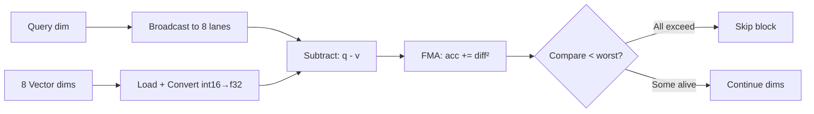
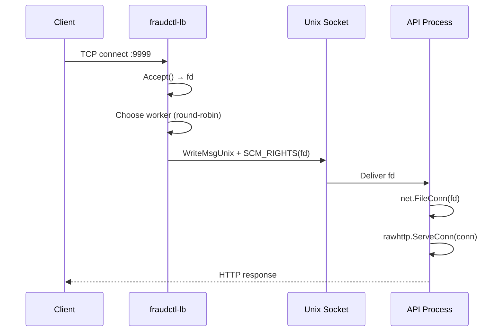
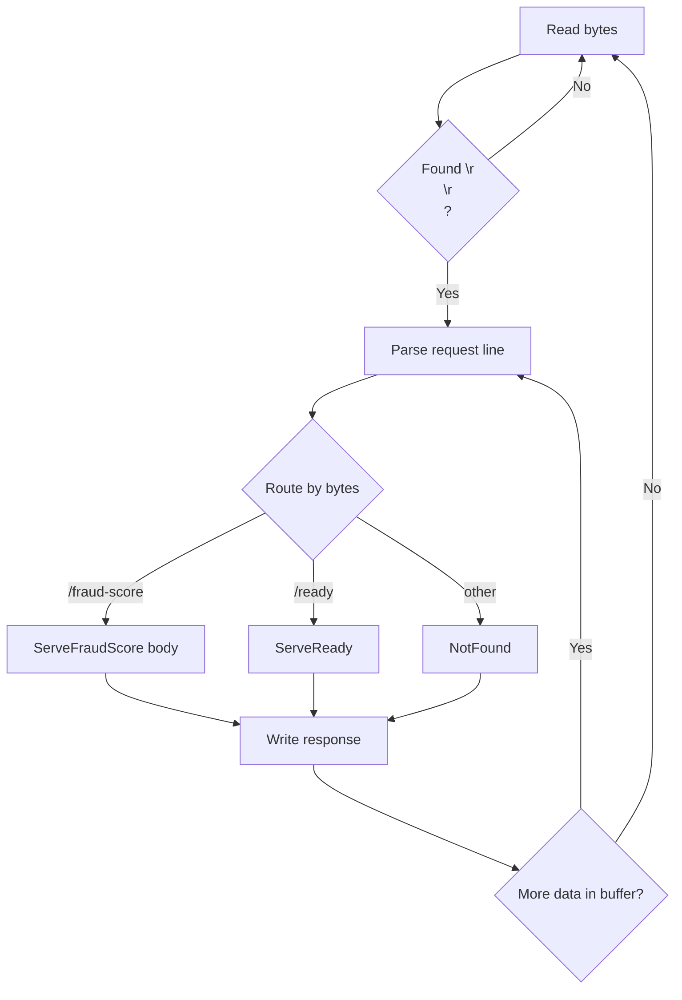
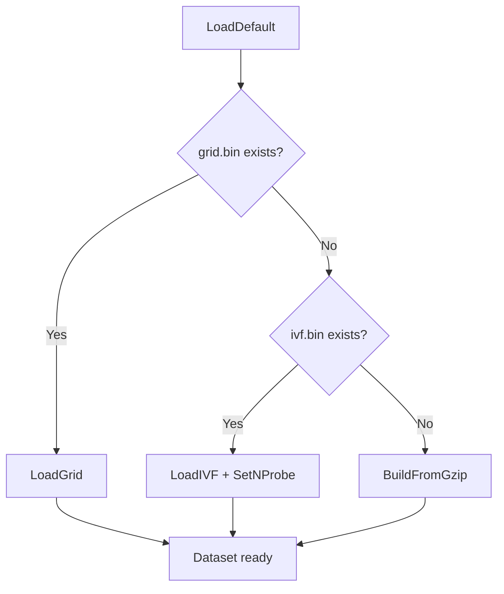
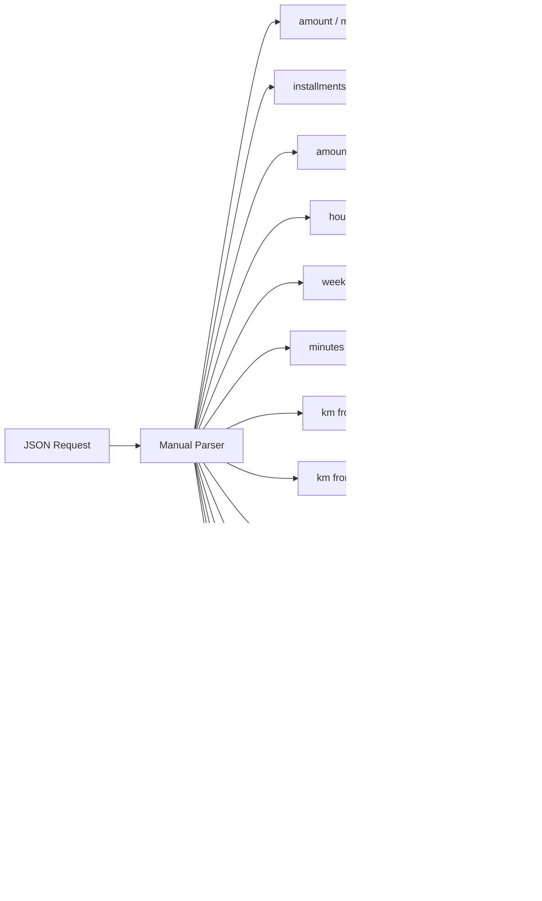

# Fundamentos do Projeto fraudctl

Este documento cobre **todos os conceitos fundamentais** implementados no projeto: matemática, algoritmos, padrões Go, técnicas de decisão, arquitetura e otimizações.

## Índice

1. [Matemática Fundamental](#matemática-fundamental)
2. [Algoritmos de Busca KNN](#algoritmos-de-busca-knn)
3. [Estruturas de Dados Espaciais](#estruturas-de-dados-espaciais)
4. [Técnicas de Decisão](#técnicas-de-decisão)
5. [Padrões Go Fundamentais](#padrões-go-fundamentais)
6. [Concorrência e Sincronização](#concorrência-e-sincronização)
7. [Otimizações de Baixo Nível](#otimizações-de-baixo-nível)
8. [Arquitetura de Sistema](#arquitetura-de-sistema)
9. [Processamento de Dados](#processamento-de-dados)
10. [Redes e Protocolos](#redes-e-protocolos)

---

## 1. Matemática Fundamental

### 1.1 Distância Euclidiana Quadrada (L2²)

**Conceito:** Medida de similaridade entre dois vetores no espaço euclidiano.

```
d²(q, v) = Σ(q[i] - v[i])²
```

**Por que quadrada?** Evita a operação de raiz quadrada (cara em CPU) sem alterar a ordenação dos vizinhos mais próximos.

```go
// internal/knn/grid.go — exactI64Dist
func exactI64Dist(qi *[DIM]int16, block *int16, lane int) uint64 {
    var ssd uint64  // Sum of Squared Differences
    blockArr := (*[DIM * gridBlockLANES]int16)(unsafe.Pointer(block))
    for d := 0; d < DIM; d++ {
        diff := int64(qi[d]) - int64(blockArr[d*gridBlockLANES+lane])
        ssd += uint64(diff * diff)  // (q - v)²
    }
    return ssd
}
```

**Propriedade matemática:** Se `d²(a,b) < d²(a,c)` então `d(a,b) < d(a,c)`. A ordenação é preservada.

### 1.2 Produto Escalar e Norma (IVF)

**Conceito:** Para IVF, a distância L2 pode ser calculada via produto escalar:

```
||q - c||² = ||q||² + ||c||² - 2 · (q · c)
```

Onde:
- `||q||²` = norma da query (calculada por request)
- `||c||²` = norma do centroide (pré-computada)
- `q · c` = produto escalar (calculado via SIMD)

```go
// internal/knn/ivf_search.go — computeQueryNorm
func computeQueryNorm(q [DIM]int16) float32 {
    var n float32
    for d := 0; d < DIM; d++ {
        v := float32(q[d])
        n += v * v  // ||q||²
    }
    return n
}

// dotToDist converte produto escalar em distância L2
func dotToDist(qNorm, cNorm, dot float32) float32 {
    return qNorm + cNorm - 2*dot  // ||q||² + ||c||² - 2(q·c)
}
```

### 1.3 Quantização Uniforme

**Conceito:** Mapear valores float32 ∈ [0, 1] para int16 ∈ [0, 10000].

```
q_int = round(q_float × scale)
```

```go
const int16Scale = 10000

func quantizeFloat32(v float32) int16 {
    return int16(v * int16Scale)
}
```

**Erro máximo:** 1/scale = 0.0001 (4 casas decimais). Para features normalizadas em [0,1], isso é insignificante.

**Economia:** 50% de memória (2 bytes vs 4 bytes por dimensão).

### 1.4 Lower Bound de Bounding Box

**Conceito:** Distância mínima entre um ponto e um hiper-retângulo (bounding box).

```
LB(q, bbox) = Σ max(0, q[i] - bboxMax[i])² + max(0, bboxMin[i] - q[i])²
```

```
         bboxMin[i]          bboxMax[i]
              |                  |
    ----------|==================|----------
              |                  |
              q[i] (dentro) → diff = 0

              bboxMin[i]     bboxMax[i]
                   |              |
    ---------------|==============|----------
                   |              |
    q[i] (fora) →  |← diff →|
```

```go
// internal/knn/grid.go — gridBBoxLowerBound (desenrolado)
func gridBBoxLowerBound(q *[DIM]int16, bmin, bmax *[DIM]int16) uint64 {
    var d uint64
    qi0 := int32(q[0])
    if qi0 < int32(bmin[0]) {
        diff := int32(bmin[0]) - qi0
        d += uint64(diff) * uint64(diff)
    } else if qi0 > int32(bmax[0]) {
        diff := qi0 - int32(bmax[0])
        d += uint64(diff) * uint64(diff)
    }
    // ... repetido para dims 1-13
    return d
}
```

**Aplicação:** Se `LB(q, bbox) >= worstDist`, nenhum vetor dentro da bbox pode ser mais próximo que o pior candidato atual → skip.

### 1.5 Regressão Logística (Legado)

**Conceito:** Modelo linear com função sigmoide para classificação binária.

```
P(y=1|x) = σ(w·x + b) = 1 / (1 + e^(-(w·x + b)))
```

**Expansão de features:** Inclui termos de interação de segunda ordem.

```
x_expanded = [x₁, x₂, ..., x₁₄, x₁², x₁x₂, x₁x₃, ..., x₁₄²]
dim_expanded = 14 + 14×15/2 = 119
```

```go
// internal/logreg/model.go
func expand(v [dimInput]float32) []float64 {
    feat := make([]float64, dimExpanded)
    i := 0
    // Features originais
    for d := 0; d < dimInput; d++ {
        feat[i] = float64(v[d])
        i++
    }
    // Termos de interação (x_a × x_b para a ≤ b)
    for a := 0; a < dimInput; a++ {
        va := feat[a]
        for b := a; b < dimInput; b++ {
            feat[i] = va * feat[b]
            i++
        }
    }
    return feat
}

func sigmoid(x float64) float64 {
    if x > 20 { return 1 }      // Saturação numérica
    if x < -20 { return 0 }     // Saturação numérica
    return 1 / (1 + math.Exp(-x))
}
```

**Treinamento:** SGD com balanceamento de classes.

```
w ← w - η · (σ(w·x + b) - y) · x · weight_class
b ← b - η · (σ(w·x + b) - y) · weight_class
```

Onde `weight_class = n / (2 · n_class)` para balancear classes desiguais.

---

## 2. Algoritmos de Busca KNN

### 2.1 Brute Force (Força Bruta)

**Conceito:** Calcular distância para todos os N vetores e manter os K menores.

```
Para cada vetor v em dataset:
    d = L2²(query, v)
    se d < worstDist:
        inserir em top-K
```

**Complexidade:** O(N · D) onde N = 3M, D = 14.

```go
// internal/knn/brute_predict.go
func brutePredict(flat []float32, fraudFlags []bool, count int, query model.Vector14, k int) float64 {
    h := newTopK5()

    for i := 0; i < count; i++ {
        var dist float64
        for d := 0; d < 14; d++ {
            diff := float64(query[d]) - float64(flat[i*14+d])
            dist += diff * diff
        }
        if dist < h.worstDist() {
            h.tryInsert(uint64(dist*1e10), i)
        }
    }

    return float64(h.fraudCountFromFlags(fraudFlags)) / float64(k)
}
```

### 2.2 IVF (Inverted File Index)

**Conceito:** Dividir espaço em clusters Voronoi, buscar apenas nos clusters mais próximos.

```mermaid
flowchart TD
    Q[Query] --> CN[Compute ||q||²]
    CN --> SC[Scan all centroids]
    SC --> DS[dotToDist: ||q||² + ||c||² - 2(q·c)]
    DS --> SP[Select quickProbe nearest]
    SP --> S1[Scan quickProbe clusters]
    S1 --> FC{fraudCount in<br/>[boundaryLo, boundaryHi]?}
    FC -->|No| RET[Return fraudCount]
    FC -->|Yes| S2[Select full nprobe]
    S2 --> S3[Scan remaining clusters]
    S3 --> RET
```

**Complexidade:** O(nlist · D + nprobe · N/nlist · D)

```go
// internal/knn/ivf_search.go — PredictRaw
func (idx *IVFIndex) PredictRaw(query model.Vector14, nprobe int) int {
    qi := quantizeQuery(query)
    qNorm := computeQueryNorm(qi)

    // 1. Select probes: scan all centroids
    probes := selectTopN(idx.centroids, idx.centroidNorms, qNorm, qi, nprobe)

    // 2. Two-tier scan
    h := newTopK5()

    // Pass 1: quick probe
    for ci := 0; ci < idx.quickProbe; ci++ {
        if bboxMayImprove(idx.bboxMin, idx.bboxMax, probes[ci], qi, h.worstDist()) {
            scanCluster(idx, probes[ci], qi, &h)
        }
    }

    // Check ambiguous zone
    fc := h.fraudCount(idx.labels)
    if fc >= idx.boundaryLo && fc <= idx.boundaryHi {
        // Pass 2: expand to full nprobe
        for ci := idx.quickProbe; ci < nprobe; ci++ {
            if bboxMayImprove(idx.bboxMin, idx.bboxMax, probes[ci], qi, h.worstDist()) {
                scanCluster(idx, probes[ci], qi, &h)
            }
        }
    }

    return h.fraudCount(idx.labels)
}
```

### 2.3 KD-tree (Grid Index)

**Conceito:** Árvore binária que particiona o espaço recursivamente pela dimensão de maior variância.

```mermaid
flowchart TD
    Q[Query] --> QQ[Quantize int16]
    QQ --> PK[Partition Key 8 bits]
    PK --> PL[partitionsByKey[key] O(1)]
    PL --> BB[BBox Lower Bound]
    BB --> KD{KD-tree<br/>traversal}
    KD -->|leaf| AVX[ScanBlock8AVX2<br/>8 vectors SIMD]
    KD -->|internal| BP[Bounds pruning<br/>near child first]
    AVX --> WD{worstDist == 0?}
    WD -->|sim| RET[Return fraudCount]
    WD -->|não| OP[Other partitions<br/>with int16 bounds]
    BP --> KD
    OP --> RET
```

**Construção:**
1. Particionar por chave de 8 bits (256 possíveis)
2. Para cada partição, construir KD-tree:
   - Encontrar dimensão de maior variância (widestDim)
   - Ordenar por essa dimensão
   - Split na mediana
   - Recursar até leafSize ≤ 128

**Busca:**
1. Lookup O(1) da partição correspondente
2. Traversar KD-tree com bounds pruning
3. Scan de folhas com AVX2 (8 vetores simultâneos)
4. Early exit se worstDist = 0
5. Scan de outras partições com bounds pruning

```go
// internal/knn/grid_build.go — widestDim
func widestDim(nmin, nmax *[DIM]int16) int {
    best := 0
    bestWidth := int32(nmax[0]) - int32(nmin[0])
    for d := 1; d < DIM; d++ {
        w := int32(nmax[d]) - int32(nmin[d])
        if w > bestWidth {
            bestWidth = w
            best = d
        }
    }
    return best
}
```

### 2.4 Comparação de Algoritmos

| Algoritmo | Complexidade | Precisão | Latência | Memória |
|-----------|-------------|----------|----------|---------|
| Brute Force | O(N·D) | Exata | ~5ms | 168 MB |
| IVF | O(nlist·D + nprobe·N/nlist·D) | Aproximada | ~20μs | 95 MB |
| KD-tree (Grid) | O(log N · D) amortizado | Exata | ~115μs | 88 MB |

---

## 3. Estruturas de Dados Espaciais

### 3.1 Layout Block-Major (SoA para SIMD)

**Conceito:** Organizar vetores para que 8 vetores adjacentes tenham suas dimensões agrupadas.

```
Layout AoS (Array of Structures):
[v0_d0, v0_d1, ..., v0_d13, v1_d0, v1_d1, ..., v1_d13, ...]

Layout Block-Major (8 vetores por bloco):
[d0: v0_d0, v1_d0, ..., v7_d0]
[d1: v0_d1, v1_d1, ..., v7_d1]
...
[d13: v0_d13, v1_d13, ..., v7_d13]
```

```go
// internal/knn/grid_build.go — leaf construction
blockVectors := make([]int16, DIM*gridBlockLANES)  // 14 × 8 = 112

for b := 0; b < nBlocks; b++ {
    for d := range DIM {
        for lane := range gridBlockLANES {
            vecIdx := b*gridBlockLANES + lane
            if vecIdx < len(members) {
                m := members[vecIdx]
                blockVectors[d*gridBlockLANES+lane] = gb.vecs[int(m)*DIM+d]
            }
        }
    }
    reordered = append(reordered, blockVectors...)
}
```

**Vantagem:** Permite carregar 8 valores de uma dimensão em um registrador YMM (256 bits) com uma única instrução.

### 3.2 Labels Bit-Packed

**Conceito:** Armazenar 1 bit por label (fraud=1, legit=0).

```
labels[i>>3] & (1 << uint(i&7)) != 0 → fraud
```

```go
// internal/knn/grid.go — FraudCount
func (idx *GridIndex) FraudCount() int {
    n := 0
    for i := 0; i < idx.n; i++ {
        if (idx.labels[i>>3] & (1 << uint(i&7))) != 0 {
            n++
        }
    }
    return n
}
```

**Economia:** 1 bit por label vs 1 byte (bool) ou 4 bytes (int). Para 3M vetores: 375 KB vs 3 MB vs 12 MB.

### 3.3 Top-K Sorted Array

**Conceito:** Manter K menores distâncias em array sorted de tamanho fixo.

```
[dist₀, dist₁, dist₂, dist₃, dist₄]  ← sempre ordenado
 idx₀   idx₁   idx₂   idx₃   idx₄
```

```go
// internal/knn/ivf_search.go
type topK5 struct {
    dist  [K]uint64  // Sorted ascending
    idx   [K]int
    count int
}

//go:inline
func (h *topK5) tryInsert(dist uint64, vecIdx int) {
    if dist >= h.worstDist() { return }  // Early exit

    // Cascading insert
    i := h.count
    if i == K { i = K - 1 }
    for i > 0 && dist < h.dist[i-1] {
        h.dist[i] = h.dist[i-1]  // Shift right
        h.idx[i] = h.idx[i-1]
        i--
    }
    h.dist[i] = dist
    h.idx[i] = vecIdx
    if h.count < K { h.count++ }
}
```

**Complexidade:** O(K) por inserção, onde K=5 (constante).

---

## 4. Técnicas de Decisão

### 4.1 KNN Fraud Scoring

**Conceito:** Fraude é determinada pela maioria dos K vizinhos mais próximos.

```
fraud_score = count(fraud_neighbors) / K
approved = fraud_count < threshold
```

```
K = 5, threshold = 3

fraudCount | fraud_score | approved
-----------|-------------|----------
    0      |    0.0      |   true
    1      |    0.2      |   true
    2      |    0.4      |   true
    3      |    0.6      |   false
    4      |    0.8      |   false
    5      |    1.0      |   false
```

```go
// internal/handler/fraud_score.go
func (h *FraudScoreHandler) HandleFraudScore(body []byte) int {
    vec, err := h.vec.VectorizeJSON(body)
    if err != nil {
        return 0  // Fallback: approved
    }
    return h.knn.PredictRaw(vec, h.knn.NProbe())
}

func (h *FraudScoreHandler) ResponseForCount(count int) []byte {
    if count < 0 || count > knnK {
        return precomputedResp[0]  // approved, 0.0
    }
    return precomputedResp[count]
}
```

### 4.2 Zona Ambígua (IVF 2-Tier)

**Conceito:** Quando fraudCount está próximo do threshold (2 ou 3), expandir busca para mais clusters.

```
fraudCount ∈ [boundaryLo, boundaryHi] → expandir de quickProbe para nprobe
```

```go
// internal/knn/ivf_search.go
fc := h.fraudCount(idx.labels)
if fc >= idx.boundaryLo && fc <= idx.boundaryHi {
    // Zona ambígua: escanear mais clusters
    for ci := idx.quickProbe; ci < nprobe; ci++ {
        scanCluster(idx, probes[ci], qi, &h)
    }
}
```

### 4.3 Partition Key (8 bits)

**Conceito:** Usar features binárias/bucketizadas para particionar o espaço de busca.

```
Bit 0: last_tx >= 0
Bit 1: is_online > 0
Bit 2: card_present > 0
Bit 3: unknown_merchant > 0
Bit 4-5: mcc_bucket (0-3)
Bit 6: amount > 5000
Bit 7: tx_count > 2500
```

```go
// internal/knn/grid.go
func gridPartitionKey(v *[DIM]int16) uint32 {
    var key uint32
    if v[5] >= 0 { key |= 1 << 0 }
    if v[9] > 0 { key |= 1 << 1 }
    if v[10] > 0 { key |= 1 << 2 }
    if v[11] > 0 { key |= 1 << 3 }

    mcc := v[12]
    var mccBucket uint32
    switch {
    case mcc <= 2499: mccBucket = 0
    case mcc <= 4999: mccBucket = 1
    case mcc <= 7499: mccBucket = 2
    default: mccBucket = 3
    }
    key |= mccBucket << 4

    if v[2] > 5000 { key |= 1 << 6 }
    if v[8] > 2500 { key |= 1 << 7 }
    return key
}
```

**Impacto:** Reduz espaço de busca de 3M para ~15K vetores por partição (3M / 192).

---

## 5. Padrões Go Fundamentais

### 5.1 Interfaces Pequenas (Interface Segregation)

**Conceito:** Interfaces com 1-3 métodos são preferíveis.

```go
// internal/handler/fraud_score.go
type Vectorizer interface {
    Vectorize(req *model.FraudScoreRequest) model.Vector14
    VectorizeJSON(data []byte) (model.Vector14, error)
}

type KNNIndex interface {
    Predict(query model.Vector14, k int) float64
    PredictRaw(query model.Vector14, nprobe int) int
    NProbe() int
}

// internal/rawhttp/server.go
type Handler interface {
    ServeFraudScore(body []byte) []byte
    ServeReady() []byte
}
```

**Benefício:** Fácil de mockar em testes, fácil de implementar, acoplamento mínimo.

### 5.2 Dependency Inversion

**Conceito:** Depender de abstrações, não de concretizações.

```go
// Handler depende de interfaces, não de implementações concretas
type FraudScoreHandler struct {
    vec Vectorizer  // Interface, não *Vectorizer
    knn KNNIndex    // Interface, não *GridIndex
}

// Aceita qualquer implementação
func NewFraudScoreHandler(vec Vectorizer, knn KNNIndex) *FraudScoreHandler {
    return &FraudScoreHandler{vec: vec, knn: knn}
}
```

### 5.3 Zero Value Útil

**Conceito:** O valor zero de um tipo deve ser utilizável sem inicialização.

```go
// Stats funciona com zero value (todos contadores = 0)
type Stats struct {
    total        int64
    errors       int64
    // ...
}

var global Stats  // Zero value é válido

// topK5 funciona com zero value (count=0, dists=MaxUint64)
func newTopK5() topK5 {
    var h topK5
    for i := range h.dist {
        h.dist[i] = math.MaxUint64
    }
    return h
}
```

### 5.4 Error Wrapping com Contexto

**Conceito:** Envolver erros com contexto para debugging.

```go
// internal/knn/grid.go
func LoadGrid(path string) (*GridIndex, error) {
    f, err := os.Open(path)
    if err != nil {
        return nil, fmt.Errorf("open grid: %w", err)
    }
    // ...
    if err := binary.Read(f, binary.LittleEndian, &magic); err != nil || magic != gridMagic {
        return nil, fmt.Errorf("invalid grid magic (got 0x%08x)", magic)
    }
}
```

### 5.5 Accept Interfaces, Return Structs

**Conceito:** Funções aceitam interfaces como parâmetros, retornam tipos concretos.

```go
// Aceita io.Reader (interface), retorna *Model (concreto)
func LoadFrom(r io.Reader) (*Model, error) {
    data, err := io.ReadAll(r)
    // ...
    return m, nil
}
```

### 5.6 Functional Options Pattern

**Conceito:** Configurar structs com opções funcionais (usado indiretamente).

```go
// internal/dataset/dataset.go
func NewDataset(refs []model.Reference) *Dataset {
    idx := knn.NewBruteIndex()
    if len(refs) > 0 {
        // Build with provided refs
    }
    return &Dataset{index: idx}
}
```

---

## 6. Concorrência e Sincronização

### 6.1 sync.Pool para Reutilização

**Conceito:** Reutilizar objetos alocados frequentemente para reduzir pressão no GC.

```go
// internal/rawhttp/server.go
var bufPool = sync.Pool{
    New: func() any {
        b := make([]byte, readBufSize)  // 1 KiB
        return &b
    },
}

func (s *Server) ServeConn(conn net.Conn) error {
    bp := bufPool.Get().(*[]byte)
    buf := *bp
    defer bufPool.Put(bp)  // Devolve ao pool

    // Usa buf para ler HTTP...
}
```

**Por que funciona:** O GC não coleta objetos em pools; eles são reutilizados entre goroutines.

### 6.2 Atomic Counters (Lock-Free)

**Conceito:** Contadores atômicos para telemetria sem locks.

```go
// internal/middleware/logger.go
type Stats struct {
    total        int64
    errors       int64
    fraud        int64
    legit        int64
    borderZone   int64
    parseErrors  int64
    totalLatency int64
    buckets      [numBuckets]int64
    _            [8]int64  // Cache-line padding
}

func Record(elapsed time.Duration, fraudCount int, approved, parseErr bool) {
    atomic.AddInt64(&global.total, 1)
    atomic.AddInt64(&global.totalLatency, int64(elapsed))

    if fraudCount >= 3 {
        atomic.AddInt64(&global.fraud, 1)
    } else {
        atomic.AddInt64(&global.legit, 1)
    }

    if fraudCount == 2 || fraudCount == 3 {
        atomic.AddInt64(&global.borderZone, 1)
    }

    if parseErr {
        atomic.AddInt64(&global.parseErrors, 1)
    }
}
```

**Cache-line padding:** O campo `_ [8]int64` evita false sharing entre CPUs.

### 6.3 Goroutines para Background Tasks

**Conceito:** Goroutines para tarefas que não bloqueiam o hot path.

```go
// internal/knn/grid.go — Background page touching
go func() {
    ticker := time.NewTicker(10 * time.Second)
    defer ticker.Stop()
    for range ticker.C {
        for i := 0; i < len(vectors); i += 2048 {
            _ = vectors[i]  // Touch cada página para manter em memória
        }
    }
}()

// cmd/api/main.go — Graceful shutdown
go func() {
    for {
        ctrlConn, err := ctrlLn.Accept()
        if err != nil { return }
        go serveControl(ctrlConn, srv)
    }
}()

quit := make(chan os.Signal, 1)
signal.Notify(quit, syscall.SIGINT, syscall.SIGTERM)
<-quit
log.Println("shutting down")
```

### 6.4 Worker Pool (K-means Build)

**Conceito:** Paralelizar construção do índice IVF.

```go
// internal/knn/ivf_build.go
var mu sync.Mutex
var wg sync.WaitGroup

for w := 0; w < runtime.GOMAXPROCS(0); w++ {
    wg.Add(1)
    go func() {
        defer wg.Done()
        for i := range assignments {
            // Process assignment...
            mu.Lock()
            // Update centroid...
            mu.Unlock()
        }
    }()
}
wg.Wait()
```

---

## 7. Otimizações de Baixo Nível

### 7.1 SIMD com Go Assembly (AVX2)

**Conceito:** Usar instruções vetoriais de 256 bits para processar 8 float32 simultaneamente.



```asm
; internal/knn/grid_kernel.s
TEXT ·ScanBlock8AVX2(SB), NOSPLIT, $0-33
    MOVQ         q+0(FP), AX
    MOVQ         block+8(FP), BX
    VBROADCASTSS worst+16(FP), Y15

    ; Two parallel accumulators
    VXORPS Y0, Y0, Y0     ; even dims
    VXORPS Y4, Y4, Y4     ; odd dims

    ; Dim 0 → Y0
    VPMOVSXWD    (BX), Y1      ; int16×8 → int32×8
    VCVTDQ2PS    Y1, Y1        ; int32×8 → float32×8
    VBROADCASTSS (AX), Y2      ; q[0] in 8 lanes
    VSUBPS       Y1, Y2, Y2    ; diff = q - v
    VFMADD231PS  Y2, Y2, Y0    ; acc += diff²

    ; Dim 1 → Y4
    VPMOVSXWD    16(BX), Y1
    VCVTDQ2PS    Y1, Y1
    VBROADCASTSS 4(AX), Y2
    VSUBPS       Y1, Y2, Y2
    VFMADD231PS  Y2, Y2, Y4

    ; Checkpoint at dim 8
    VADDPS    Y4, Y0, Y3      ; Merge
    VCMPPS    $0x01, Y15, Y3, Y3  ; compare < worst
    VMOVMSKPS Y3, R8
    TESTL     R8, R8
    JZ        dead             ; All exceed → skip

    ; Continue dims 8-13...
```

**Instruções AVX2 usadas:**
- `VPMOVSXWD`: Sign-extend 8×int16 → 8×int32
- `VCVTDQ2PS`: Convert 8×int32 → 8×float32
- `VBROADCASTSS`: Broadcast scalar to 8 lanes
- `VSUBPS`: Subtract 8×float32
- `VFMADD231PS`: Fused multiply-add (acc += diff × diff)
- `VCMPPS`: Compare 8×float32 < worst
- `VMOVMSKPS`: Extract comparison mask to integer

### 7.2 Loop Unrolling

**Conceito:** Desenrolar loops para eliminar overhead e permitir melhor otimização do compilador.

```go
// ANTES: loop
func gridBBoxLowerBound(q *[DIM]int16, bmin, bmax *[DIM]int16) uint64 {
    var d uint64
    for i := 0; i < 14; i++ {
        qi := int32(q[i])
        if qi < int32(bmin[i]) {
            diff := int32(bmin[i]) - qi
            d += uint64(diff) * uint64(diff)
        } else if qi > int32(bmax[i]) {
            diff := qi - int32(bmax[i])
            d += uint64(diff) * uint64(diff)
        }
    }
    return d
}

// DEPOIS: unrolled
func gridBBoxLowerBound(q *[DIM]int16, bmin, bmax *[DIM]int16) uint64 {
    var d uint64
    qi0 := int32(q[0])
    if qi0 < int32(bmin[0]) {
        diff := int32(bmin[0]) - qi0
        d += uint64(diff) * uint64(diff)
    } else if qi0 > int32(bmax[0]) {
        diff := qi0 - int32(bmax[0])
        d += uint64(diff) * uint64(diff)
    }
    // ... qi1 through qi13
    return d
}
```

### 7.3 Precomputed Responses

**Conceito:** Pré-computar respostas HTTP completas no init().

```go
// internal/rawhttp/server.go
var fraudResponses [6][]byte

func init() {
    bodies := [6]string{
        `{"approved":true,"fraud_score":0.0}`,
        `{"approved":true,"fraud_score":0.2}`,
        `{"approved":true,"fraud_score":0.4}`,
        `{"approved":false,"fraud_score":0.6}`,
        `{"approved":false,"fraud_score":0.8}`,
        `{"approved":false,"fraud_score":1.0}`,
    }

    for i, body := range bodies {
        fraudResponses[i] = buildOKResponse("application/json", body)
    }
}

// Hot path: zero CPU
func FraudResponse(count int) []byte {
    return fraudResponses[count]
}
```

### 7.4 Multiplication by Inverse

**Conceito:** Substituir divisão por multiplicação (mais rápida em CPU).

```go
// ANTES: divisão no hot path
vec[0] = float32(amount) / norm.MaxAmount

// DEPOIS: multiplicação por inverso pré-computado
type Vectorizer struct {
    invMaxAmount float32  // 1.0 / norm.MaxAmount
}

vec[0] = float32(amount) * v.invMaxAmount
```

---

## 8. Arquitetura de Sistema

### 8.1 FD Passing via SCM_RIGHTS

**Conceito:** Transferir file descriptors entre processos via Unix domain sockets.



```go
// Lado do LB
func passFD(conn net.TCPConn, workerUnix *net.UnixConn) {
    f, _ := conn.File()
    fd := int(f.Fd())
    oob := syscall.UnixRights(fd)
    workerUnix.WriteMsgUnix([]byte{0}, oob, nil)
    f.Close()
}

// Lado da API — parse manual (zero alloc)
func parseUnixRights(oob []byte) (int, error) {
    if len(oob) < 20 { return -1, nil }
    level := int(oob[8]) | int(oob[9])<<8 | int(oob[10])<<16 | int(oob[11])<<24
    typ := int(oob[12]) | int(oob[13])<<8 | int(oob[14])<<16 | int(oob[15])<<24
    if level != syscall.SOL_SOCKET || typ != syscall.SCM_RIGHTS {
        return -1, nil
    }
    fd := int(oob[16]) | int(oob[17])<<8 | int(oob[18])<<16 | int(oob[19])<<24
    return fd, nil
}
```

### 8.2 HTTP Server Minimalista

**Conceito:** Parser HTTP manual orientado a bytes.



```go
func (s *Server) ServeConn(conn net.Conn) error {
    bp := bufPool.Get().(*[]byte)
    buf := *bp
    pos, used := 0, 0
    defer bufPool.Put(bp)

    for {
        headEnd := indexHeaderEnd(buf[pos:used])
        for headEnd < 0 {
            n, err := conn.Read(buf[used:])
            used += n
            headEnd = indexHeaderEnd(buf[pos:used])
        }

        method, path, contentLen := parseRequestLine(buf[pos:headEnd])
        bodyEnd := headEnd + contentLen
        for used < bodyEnd {
            n, _ := conn.Read(buf[used:])
            used += n
        }

        var resp []byte
        switch {
        case len(path) == 12 && path[1] == 'f':
            resp = s.handler.ServeFraudScore(buf[headEnd:bodyEnd])
        case len(path) == 6 && path[1] == 'r':
            resp = s.handler.ServeReady()
        default:
            resp = notFoundResponse
        }

        conn.Write(resp)
        pos = bodyEnd
        if pos >= used { pos, used = 0, 0 }
    }
}
```

### 8.3 Resource Loading Priority

**Conceito:** Carregar índices em ordem de prioridade (melhor → fallback).



```go
// internal/dataset/dataset.go
func LoadDefault(path string) (*Dataset, error) {
    loader := NewLoader(path)
    norm, _ := loader.LoadNormalization("")
    mccRisk, _ := loader.LoadMCCRisk("")

    var idx KNNIndex

    // Priority 1: Grid index (exact, fastest)
    gridPath := filepath.Join(path, "grid.bin")
    if _, err := os.Stat(gridPath); err == nil {
        grid, err := knn.LoadGrid(gridPath)
        if err == nil { idx = grid }
    }

    // Priority 2: IVF index (approximate, fast)
    if idx == nil {
        ivfPath := filepath.Join(path, "ivf.bin")
        if _, err := os.Stat(ivfPath); err == nil {
            ivf, err := knn.LoadIVF(ivfPath)
            if err == nil {
                ivf.SetNProbe(IVF_NPROBE)
                ivf.SetRetry(IVF_QUICK_PROBE, IVF_BOUNDARY_LO, IVF_BOUNDARY_HI)
                idx = ivf
            }
        }
    }

    // Priority 3: Brute force (fallback)
    if idx == nil {
        brute := knn.NewBruteIndex()
        brute.BuildFromGzip(filepath.Join(path, "references.json.gz"), 3_000_000)
        idx = brute
    }

    return &Dataset{norm: norm, mccRisk: mccRisk, index: idx}, nil
}
```

---

## 9. Processamento de Dados

### 9.1 Vectorização de Features

**Conceito:** Transformar transação JSON em vetor numérico de 14 dimensões.



```go
// internal/vectorizer/vectorizer.go
func (v *Vectorizer) Vectorize(req *model.FraudScoreRequest) model.Vector14 {
    var vec model.Vector14

    // dim 0: amount normalized
    vec[0] = clampFloat32(float32(req.Transaction.Amount) * v.invMaxAmount)

    // dim 1: installments normalized
    vec[1] = clampFloat32(float32(req.Transaction.Installments) * v.invMaxInstall)

    // dim 2: amount vs customer average
    avgRatio := req.Transaction.Amount / req.Customer.AvgAmount
    vec[2] = clampFloat32(float32(avgRatio) * v.invAmountRatio)

    // dim 3-4: hour and weekday
    t := req.Transaction.RequestedAtTime()
    vec[3] = float32(t.Hour()) / 23.0
    vec[4] = float32(t.Weekday()) / 6.0

    // dim 5-6: minutes and km from last tx (-1 if null)
    if req.LastTransaction == nil {
        vec[5] = -1
        vec[6] = -1
    } else {
        minutes := req.RequestedAtTime().Sub(req.LastTransaction.TimestampTime()).Minutes()
        vec[5] = clampFloat32(float32(minutes) * v.invMaxMinutes)
        vec[6] = clampFloat32(float32(req.LastTransaction.KmFromCurrent) * v.invMaxKM)
    }

    // dim 7: km from home
    vec[7] = clampFloat32(float32(req.Terminal.KmFromHome) * v.invMaxKM)

    // dim 8: tx count 24h
    vec[8] = clampFloat32(float32(req.Customer.TxCount24h) * v.invMaxTxCount)

    // dim 9-11: binary flags
    vec[9] = boolFloat32(req.Terminal.IsOnline)
    vec[10] = boolFloat32(req.Terminal.CardPresent)
    vec[11] = boolFloat32(!v.isKnownMerchant(req.Merchant.ID, req.Customer.KnownMerchants))

    // dim 12: MCC risk score
    vec[12] = v.mccRisk.Get(req.Merchant.MCC)

    // dim 13: merchant average amount
    vec[13] = clampFloat32(float32(req.Merchant.AvgAmount) * v.invMerchantAvg)

    return vec
}
```

### 9.2 Streaming JSON Loader

**Conceito:** Carregar dataset de 3M vetores sem alocar tudo em memória de uma vez.

```go
// internal/dataset/loader.go
func (l *Loader) LoadReferences() ([]model.Reference, error) {
    f, err := os.Open(filepath.Join(l.basePath, "references.json.gz"))
    if err != nil { return nil, err }
    defer f.Close()

    gz, err := gzip.NewReader(f)
    if err != nil { return nil, err }
    defer gz.Close()

    dec := json.NewDecoder(gz)
    dec.Token()  // Skip '['

    var refs []model.Reference
    var entry model.Reference
    for dec.More() {
        if err := dec.Decode(&entry); err != nil { break }
        refs = append(refs, entry)
    }
    return refs, nil
}
```

### 9.3 Clamping e Normalização

**Conceito:** Limitar valores ao intervalo [0, 1] para consistência do modelo.

```go
func clampFloat32(val float32) float32 {
    if val < 0 { return 0 }
    if val > 1 { return 1 }
    return val
}
```

**Exceção:** `vec[5]` e `vec[6]` podem ser -1 quando não há transação anterior.

---

## 10. Redes e Protocolos

### 10.1 HTTP/1.1 Manual

**Conceito:** Parser HTTP minimalista sem dependência de `net/http`.

```
Request:
POST /fraud-score HTTP/1.1\r\n
Content-Length: 384\r\n
\r\n
{"id":"tx-123","transaction":{...}}

Response:
HTTP/1.1 200 OK\r\n
Content-Type: application/json\r\n
Content-Length: 40\r\n
\r\n
{"approved":true,"fraud_score":0.0}
```

```go
func parseRequestLine(buf []byte) (method, path []byte, contentLen int) {
    // Parse method
    i := 0
    for i < len(buf) && buf[i] != ' ' { i++ }
    method = buf[:i]

    // Parse path
    i++
    j := i
    for j < len(buf) && buf[j] != ' ' { j++ }
    path = buf[i:j]

    // Parse Content-Length
    contentLen = findContentLength(buf[j:])
    return
}
```

### 10.2 Unix Domain Sockets

**Conceito:** Comunicação inter-processo via filesystem sockets.

```go
// API side
ctrlLn, _ := net.Listen("unix", ctrlSocket)
os.Chmod(ctrlSocket, 0666)  // Allow LB to connect

// LB side
workerUnix, _ := net.DialUnix("unix", nil, &net.UnixAddr{Name: path, Net: "unix"})
```

### 10.3 TCP Connection Handling

**Conceito:** Configurar TCP para baixa latência.

```go
if tc, ok := conn.(*net.TCPConn); ok {
    tc.SetNoDelay(true)      // Disable Nagle's algorithm
    tc.SetKeepAlive(true)    // Enable keepalive
}
```

**Nagle's Algorithm:** Agrupa pequenos pacotes para eficiência. Desabilitar para baixa latência.

---

## Resumo de Conceitos por Categoria

| Categoria | Conceitos |
|-----------|-----------|
| **Matemática** | Distância L2², Produto Escalar, Norma, Quantização Uniforme, Lower Bound de BBox, Regressão Logística, Sigmoide |
| **Algoritmos** | Brute Force KNN, IVF, KD-tree, K-means, Top-K sorted insertion, Bounds pruning, Early exit |
| **Estruturas de Dados** | Block-major layout, Bit-packed labels, Sorted array top-K, SoA centroids, KD-tree nodes |
| **Decisão** | KNN voting, Zona ambígua 2-tier, Partition key 8 bits, Threshold-based approval |
| **Go Patterns** | Interfaces pequenas, DIP, Zero value útil, Error wrapping, sync.Pool, Atomic counters, Functional options |
| **Concorrência** | Goroutines, sync.Pool, atomic.AddInt64, sync.WaitGroup, sync.Mutex, Channel-based shutdown |
| **Otimizações** | SIMD AVX2, Loop unrolling, Precomputed responses, Multiplication by inverse, Cache-line padding, PREFETCHT0 |
| **Arquitetura** | FD passing SCM_RIGHTS, HTTP parser manual, Resource loading priority, Round-robin LB |
| **Redes** | HTTP/1.1 manual, Unix domain sockets, TCP_NODELAY, Keepalive, Read/Write deadlines |
